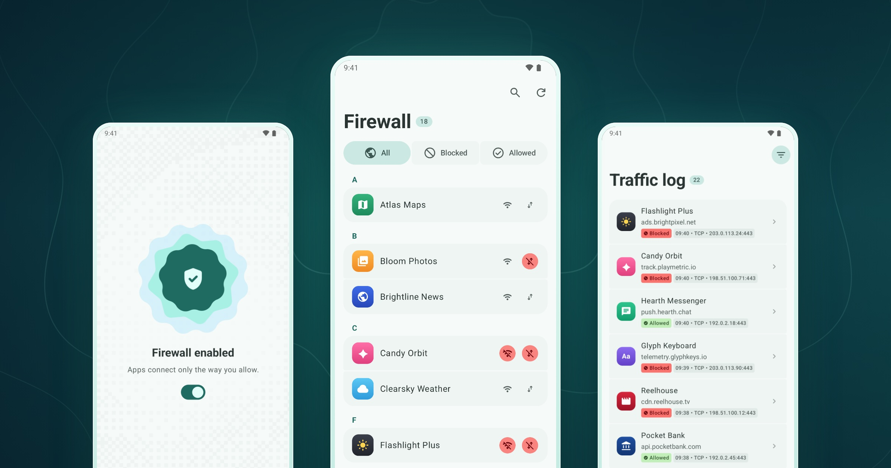
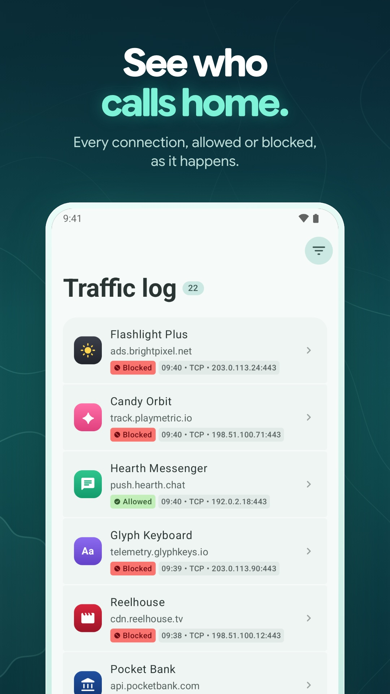
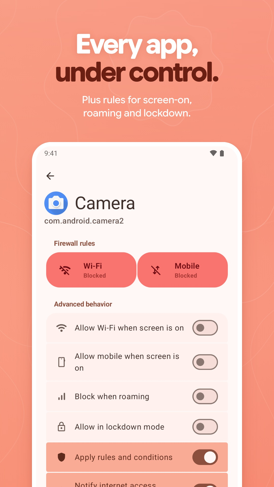
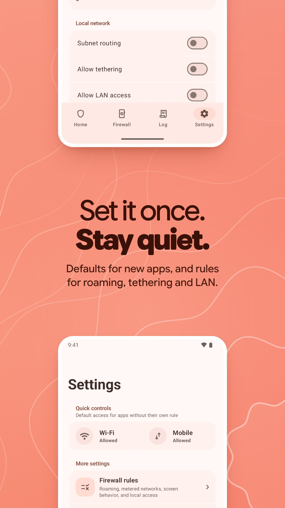
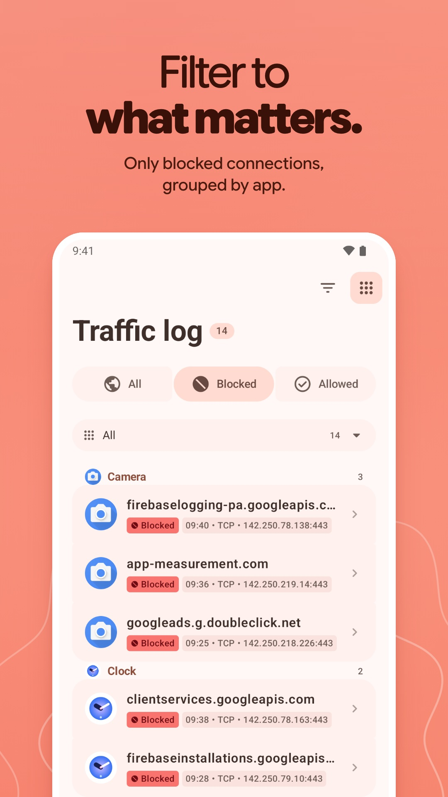
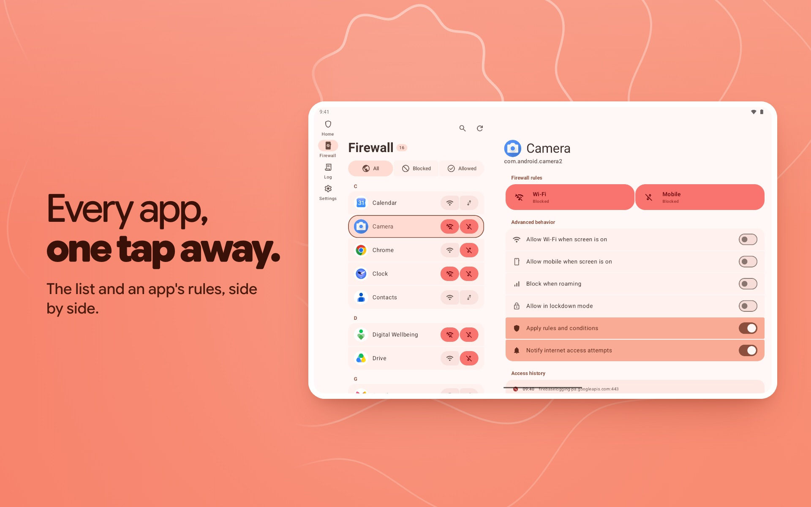

  

<h1 align="center">QuietGuard</h1>

<strong>Decide which apps reach the internet.</strong>

A private, no-root firewall for Android. Block Wi-Fi or mobile data app by app, see who tried to connect, and keep all of it on your phone.

  

  <a href="https://quietguard.vercel.app/">Web demo</a> ·
  <a href="docs/ARCHITECTURE.md">Architecture</a> ·
  <a href="docs/THREAT-MODEL.md">Threat model</a> ·
  <a href="docs/PROVENANCE.md">What I wrote vs inherited</a>

  

## Quiet by default

<table>
  <tr>
    <td width="25%"></td>
    <td width="25%"></td>
    <td width="25%"></td>
    <td width="25%"></td>
  </tr>
</table>

- **Two switches per app.** Allow or block Wi-Fi and mobile data separately, so video can wait for Wi-Fi while the camera never connects at all.
- **A log you can read.** Every connection shows the app, the domain, and whether it got through. Filter to blocked ones and group them by app.
- **Rules for the edge cases.** Allow an app only while the screen is on, block roaming, lock everything down, and set what new apps get by default.

## From NetGuard to QuietGuard

The same phone and the same apps, in NetGuard and in QuietGuard. Every screen is redrawn with Material 3: clear Wi-Fi and mobile switches per app, and settings you can read at a glance.

  

QuietGuard is a fork of [NetGuard](https://github.com/M66B/NetGuard), Marcel Bokhorst's no-root firewall, and stays under the GPLv3. The interface and app logic are rewritten in Kotlin Multiplatform and Compose, with a packet engine in Rust.

## On a bigger screen

The app list and an app's rules sit side by side on tablets and foldables.

  

## Private by design

QuietGuard filters on the device through Android's `VpnService`: traffic is not routed through a QuietGuard server, and there is no account, tracking, or analytics. Update checks are off unless you turn them on. It is a local firewall, not an anonymity tool; the [threat model](docs/THREAT-MODEL.md) spells out what it does and does not protect.

Building from source, releases, or contributing? See [docs/DEVELOPMENT.md](docs/DEVELOPMENT.md).
