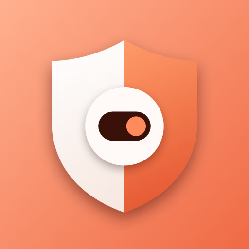
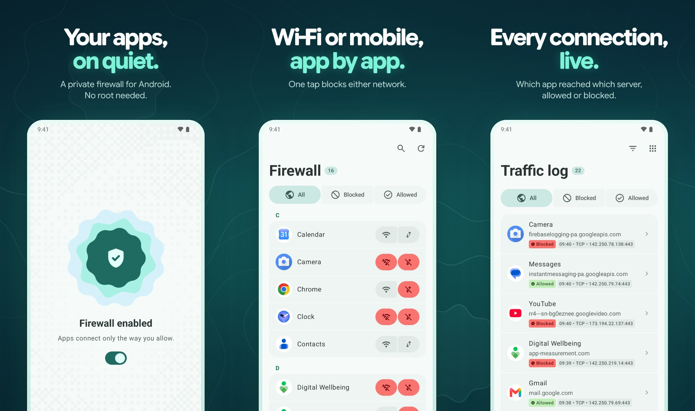
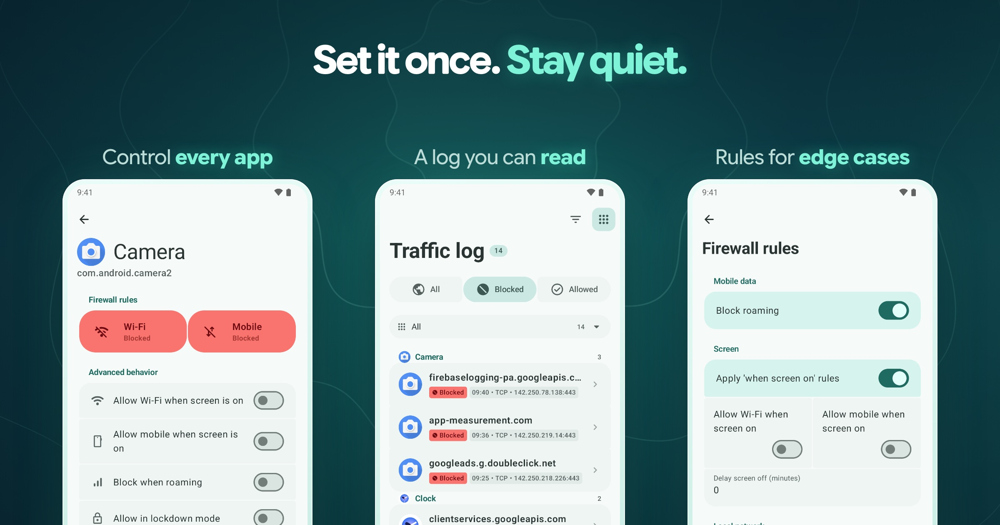
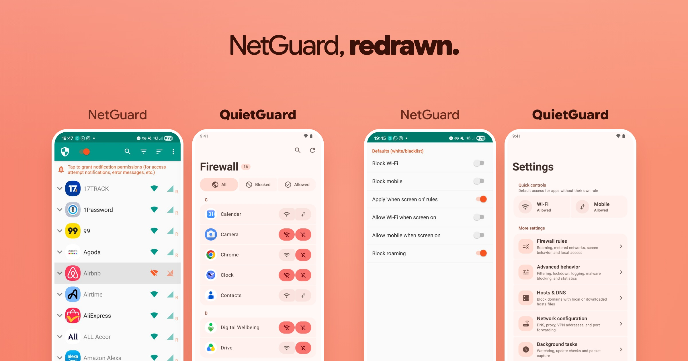

  

<h1 align="center">QuietGuard</h1>

<strong>Decide which apps reach the internet.</strong>

A private firewall for Android. No root, no account, nothing leaves your phone.

  

<a href="https://quietguard.vercel.app/"><strong>Try the web demo</strong></a>

  

## Quiet by default

  

- **Control every app.** Wi-Fi and mobile data are separate, so video can wait for Wi-Fi while the camera never connects at all.
- **A log you can read.** Every connection shows the app, the server and whether it got through. Filter to the blocked ones, grouped by app.
- **Rules for the edge cases.** Allow an app only while the screen is on, block roaming, lock everything down, and choose what new apps get.

## From NetGuard to QuietGuard

The same phone and the same apps, before and after. Every screen is redrawn with Material 3.

  

QuietGuard is a fork of [NetGuard](https://github.com/M66B/NetGuard), Marcel Bokhorst's no-root firewall, and stays under the GPLv3. The interface and app logic are rewritten in Kotlin Multiplatform and Compose, with a packet engine in Rust. [What I wrote and what I inherited](docs/PROVENANCE.md).

## Private by design

QuietGuard filters on the device through Android's `VpnService`. Traffic never goes through a QuietGuard server, and there is no account, tracking or analytics. Update checks stay off unless you turn them on.

It is a local firewall, not an anonymity tool. The [threat model](docs/THREAT-MODEL.md) spells out what it protects and what it doesn't.

Building from source or contributing? See [DEVELOPMENT.md](docs/DEVELOPMENT.md) and [ARCHITECTURE.md](docs/ARCHITECTURE.md).
