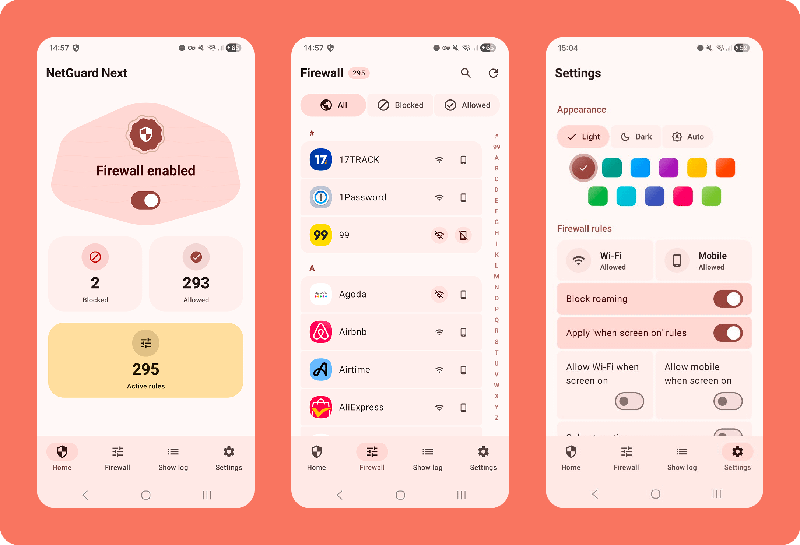
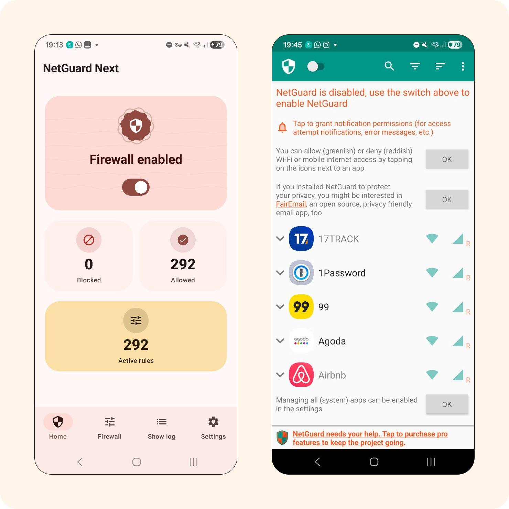
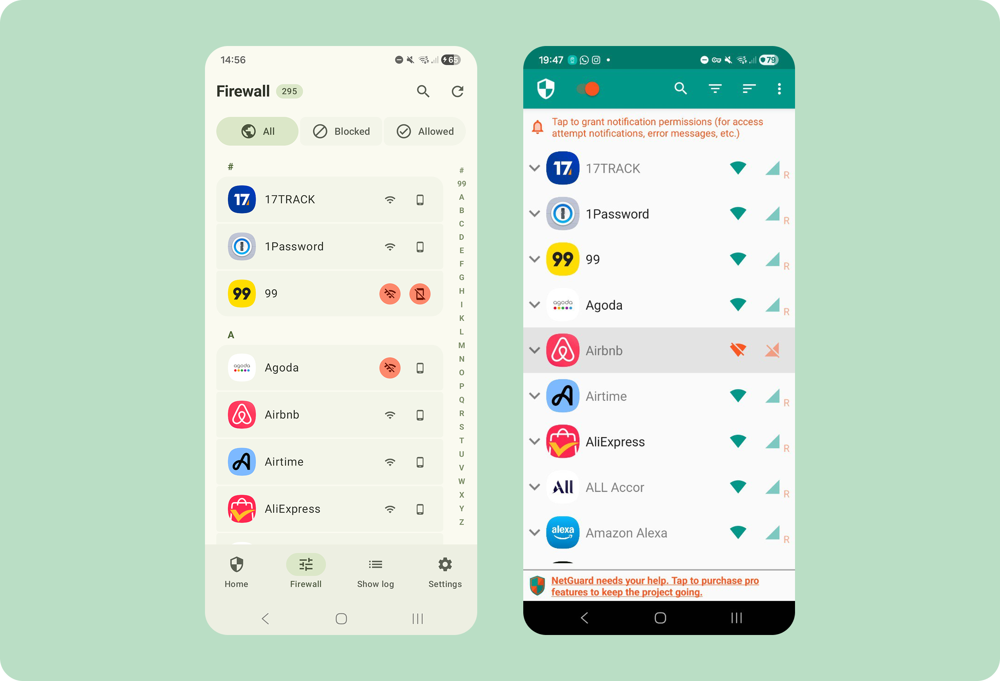
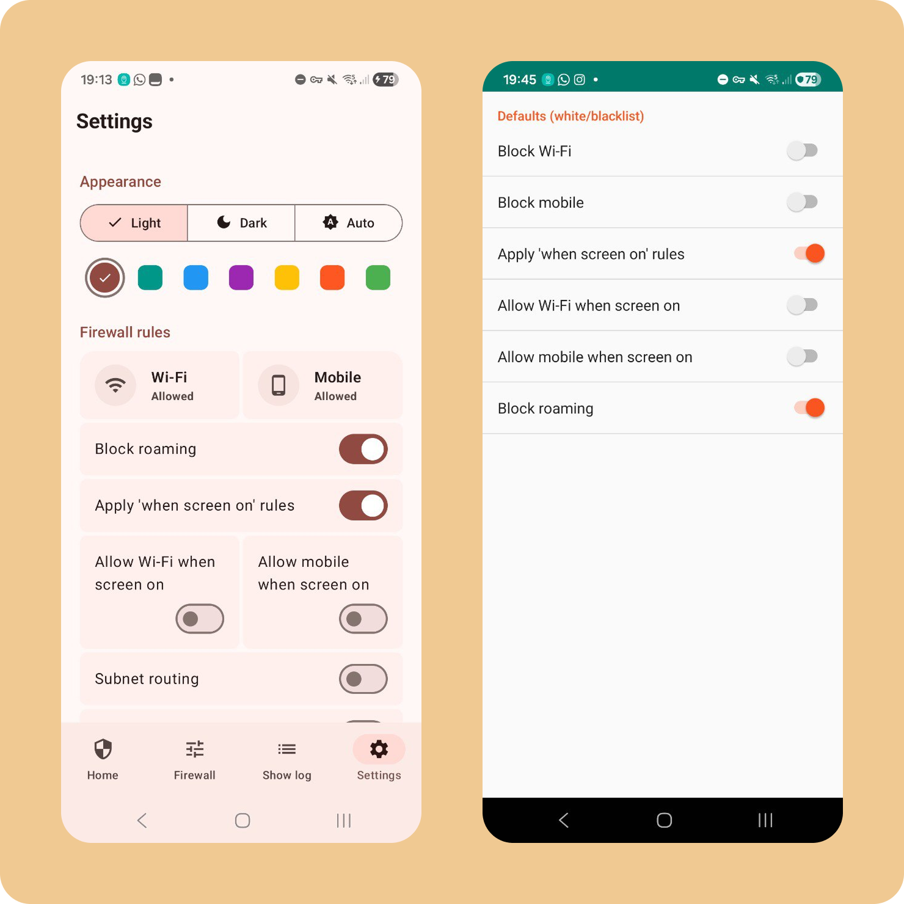
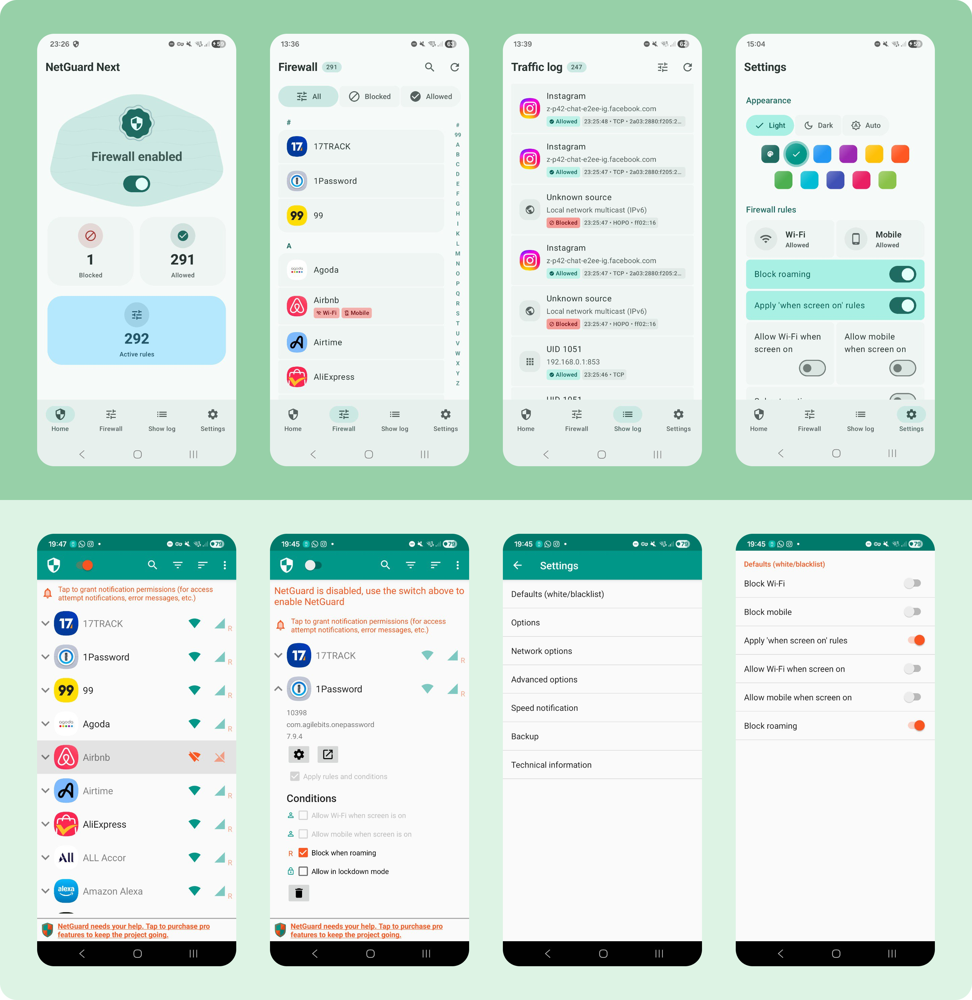
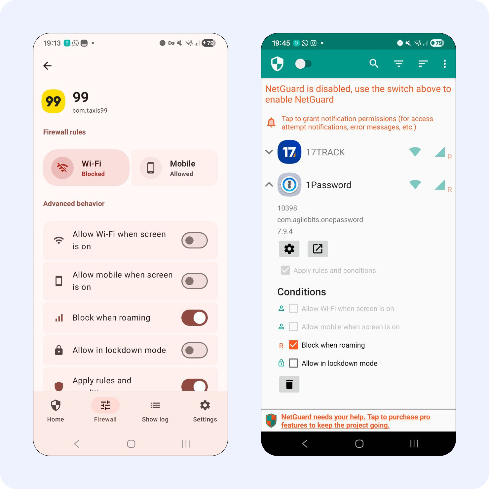
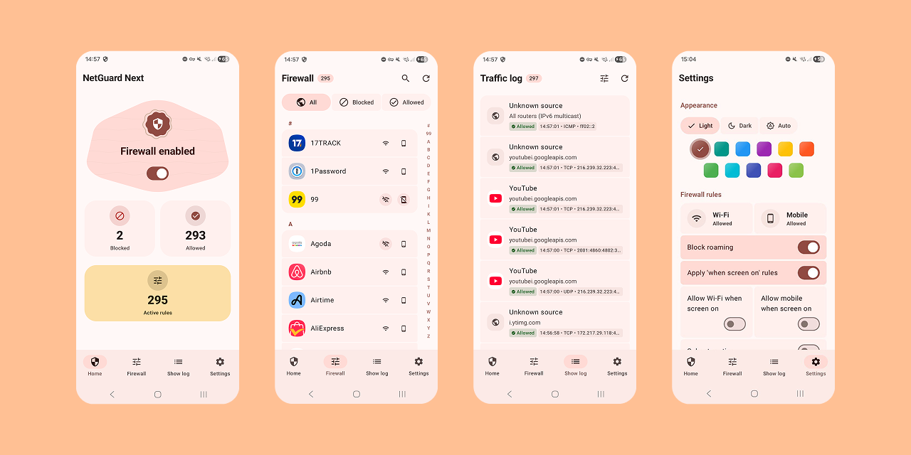
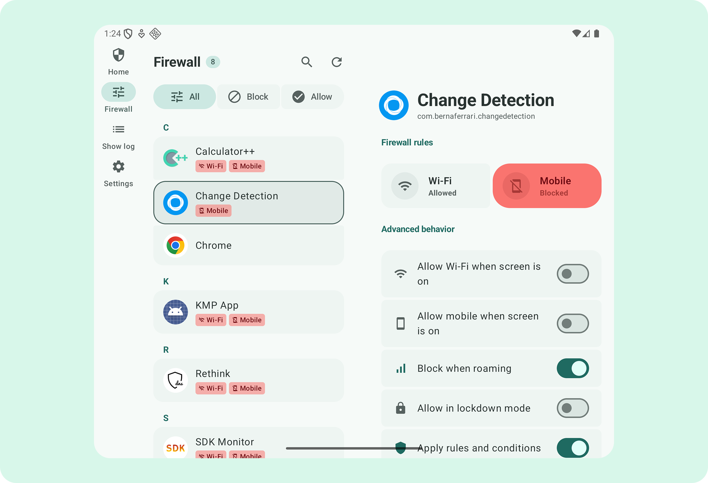
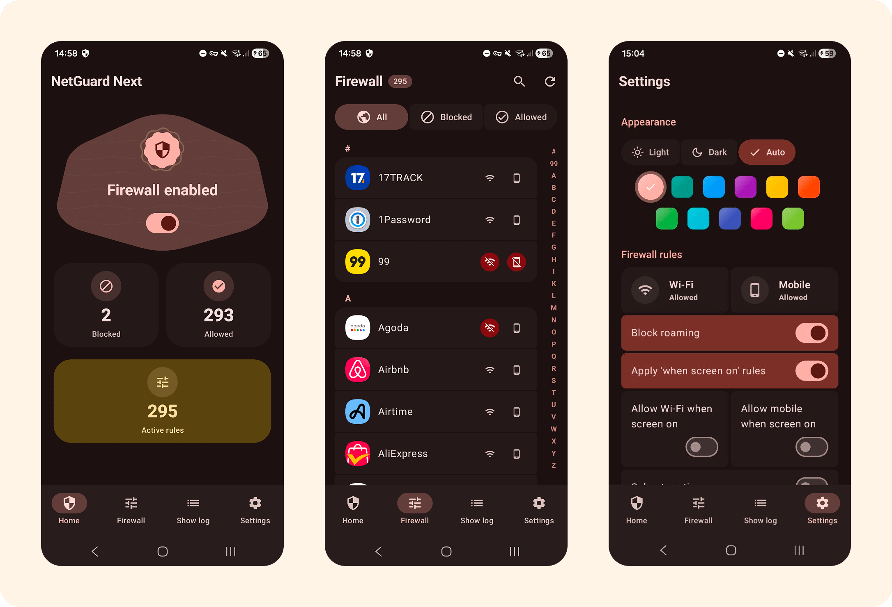

# QuietGuard

<p align="center">
  
</p>

<p align="center">
  <strong>A private, no-root Android firewall with clear per-app network controls.</strong><br>
  Local <code>VpnService</code> sinkhole — Kotlin Multiplatform UI, Compose, and a Rust packet engine.
</p>

<p align="center">
  <a href="https://github.com/bernaferrari/QuietGuard/actions/workflows/ci.yml"></a>
  <a href="https://github.com/bernaferrari/QuietGuard/releases"></a>
  <a href="LICENSE"></a>
</p>

<p align="center">
  <a href="https://quietguard.vercel.app/"><strong>Try the Web Demo</strong></a>
  ·
  <a href="docs/ARCHITECTURE.md">Architecture</a>
  ·
  <a href="docs/THREAT-MODEL.md">Threat model</a>
  ·
  <a href="docs/PROVENANCE.md">What I wrote vs inherited</a>
</p>

---

QuietGuard lets you decide which Android apps can use Wi-Fi or mobile data. Filtering runs on the device through Android’s VPN API: no QuietGuard account, remote QuietGuard proxy, tracking, or analytics are required for the core firewall loop.

This repository is a **GitHub fork** of [NetGuard](https://github.com/M66B/NetGuard). The git history still carries thousands of inherited commits. The product surface is a KMP / Compose / Rust rewrite — not a reskin of the original Java/C tree. Details: [docs/PROVENANCE.md](docs/PROVENANCE.md).

## Highlights

- **On-device filtering:** Android `VpnService` sinkhole; traffic is not sent through a QuietGuard server.
- **Per-app control:** Allow or block Wi-Fi and mobile data independently for each app.
- **Readable activity logs:** See what connected, what was blocked, and related metadata stored locally.
- **Modern adaptive UI:** Compose Multiplatform + Material 3 for phones, tablets, and foldables.
- **Rust packet engine:** Local VPN path in `app/src/main/rust` (UniFFI → Kotlin on Android).
- **Web demo:** [quietguard.vercel.app](https://quietguard.vercel.app/) explores the UI only — it does **not** filter device traffic.

## Screenshots

| Home / overview | Firewall | Settings |
|---|---|---|
|  |  |  |



<details>
<summary>More screenshots</summary>

<p align="center">
  
  
  
</p>

</details>

## QuietGuard vs NetGuard

| | **QuietGuard** | **NetGuard** (upstream) |
|--|----------------|-------------------------|
| **Lineage** | Fork of NetGuard; GPLv3 | Original project by Marcel Bokhorst |
| **UI** | Kotlin Multiplatform + Compose + Material 3 | Classic Android views |
| **Packet engine** | Rust via UniFFI (`app/src/main/rust`) | C/JNI |
| **Platforms** | Android + Wasm web demo | Android |
| **Install** | [This repo’s Releases](https://github.com/bernaferrari/QuietGuard/releases) or build from source | [Upstream APKs](https://github.com/M66B/NetGuard/releases) |
| **CI** | Web verify + host `cargo test` (no NDK) | Upstream’s own pipeline |

QuietGuard does **not** ship NetGuard binaries under a new name. Full authorship split and how to re-verify: [docs/PROVENANCE.md](docs/PROVENANCE.md).

## Architecture

```text
Compose screens → ViewModels → repositories / platform bridges
        ↓                    ↓                     ↓
   Android VpnService    Rust engine           Wasm demo (UI only)
```

Modules: `:app` (host), `:shared` (KMP UI + domain), `:webApp`, `:sqliteWasmWorker`.
Rules and dependency direction: [docs/ARCHITECTURE.md](docs/ARCHITECTURE.md).

## Threat model (short)

Local sinkhole, not a remote VPN or anonymity tool. In scope: per-app block/allow on device. Out of scope: root malware, hiding allowed traffic, treating the web demo as a firewall. Residual app HTTP (opt-in update check, user-triggered hosts download, optional SOCKS5) is documented in [docs/THREAT-MODEL.md](docs/THREAT-MODEL.md).

## Install

### Prebuilt APK (QuietGuard)

When a `v*` tag is pushed, GitHub Actions publishes a **debug-signed** arm64 QuietGuard APK on
[Releases](https://github.com/bernaferrari/QuietGuard/releases/latest). That build is from **this** repo — not NetGuard.

Until a tag exists, the Releases page is empty; use build-from-source below.

Optional: add repo secrets (`SIGNING_STORE_BASE64`, `SIGNING_STORE_PASSWORD`, `SIGNING_KEY_ALIAS`, `SIGNING_KEY_PASSWORD`) to publish a **release-signed** APK instead. See [`.github/workflows/release.yml`](.github/workflows/release.yml).

### Android from source

Prerequisites: JDK 17+, Android SDK/NDK (`quietguard.ndkVersion` in `gradle.properties`), Rust/Cargo.

```bash
./gradlew :app:assembleDebug
./gradlew :app:installDebug
```

Local Android check (host tests + optional arm64 debug APK — **not** run on every GitHub push):

```bash
./scripts/verify-android-ci.sh
```

Do **not** install upstream NetGuard APKs and expect QuietGuard UI/engine behavior.

### Web

```bash
./gradlew :webApp:wasmJsBrowserDevelopmentRun
./scripts/simulate-web-ci.sh          # production Wasm bundle + checks
```

Deploy: [quietguard.vercel.app](https://quietguard.vercel.app/) (UI demo only).

## Continuous integration

Every push/PR runs [`.github/workflows/ci.yml`](.github/workflows/ci.yml) — intentionally **not** a full Android/NDK assemble (that is slow on GitHub and is why the web job exists).

| Job | What it runs |
|-----|----------------|
| **KMP web** | `./scripts/verify-web-deploy.sh --ci --web-only` |
| **Rust** | `cargo test --locked` in `app/src/main/rust` (host, no NDK) |

Android host tests + arm64 APK: `./scripts/verify-android-ci.sh` locally, or the **Release** workflow on a `v*` tag. Not in CI: multi-ABI, emulator, Play packaging.

## Behavior notes

- Local-first by default: filtering does not proxy through a QuietGuard backend.
- Update checks are **opt-in** (`update_check` defaults off). Hosts download is user-triggered. SOCKS5 defaults off.
- OEM VPN / battery policies can stop the tunnel; traffic is unfiltered when the service is down.
- Credits: [NetGuard](https://github.com/M66B/NetGuard) by Marcel Bokhorst (concept, GPLv3, most git history); QuietGuard work as listed in [docs/PROVENANCE.md](docs/PROVENANCE.md).
- License: GNU GPLv3 — [LICENSE](LICENSE).

<p align="center">
  
</p>
